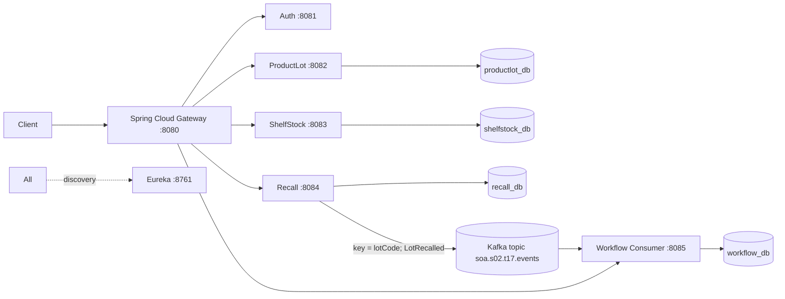

# Pharmacy Shelf Recall Routing — SOA / Microservices

Intermediate Team 17 scenario implementation for 24SDCS03. Synthetic records and simulated actions only. This repository provides separate Spring Boot apps for Auth, ProductLot, ShelfStock, Recall, Workflow Consumer, Eureka and Gateway, plus PostgreSQL and Kafka.

## Architecture and ownership



- **ProductLot** owns supplier/product/lot records. **ShelfStock** owns shelf quantities and status. **Recall** accepts recall scope and publishes `LotRecalled`. **Workflow** is a separate consumer and persists consumed-event workflow state. Auth issues signed JWTs. Gateway routes via Eureka service IDs and checks JWT/role; domain services independently validate signature and expiry.
- **Choreography** is used: Recall publishes an event; Workflow consumes it without synchronous service-to-service table access. The workflow consumer records the event as `QUARANTINED` to indicate a recall workflow is pending shelf reconciliation. This is intentionally explicit rather than pretending a remote stock update has happened.
- Event envelope: `eventId`, `aggregateId` (lot code), `schemaVersion`, `occurredAt`, `correlationId`, `lotCode`, `productCode`, `reason`. Kafka key is `lotCode` to preserve per-lot ordering.

## Start infrastructure

Requires Docker Desktop, Java 17, and Maven 3.9+. From this folder:

```bash
docker compose up -d
mvn clean package
```

Start services in separate terminals, in this order:

```bash
mvn -pl eureka-server spring-boot:run
mvn -pl auth-service spring-boot:run
mvn -pl productlot-service spring-boot:run
mvn -pl shelfstock-service spring-boot:run
mvn -pl recall-service spring-boot:run
mvn -pl workflow-service spring-boot:run
mvn -pl gateway spring-boot:run
```

Open Eureka at http://localhost:8761 and Gateway at http://localhost:8080. `ddl-auto: update` creates tables in isolated databases. Demo credentials: `recall.officer/demo123` (RECALL_OFFICER), `shelf.clerk/demo123` (SHELF_CLERK), `admin/admin123` (ADMIN). They are local synthetic credentials; change secrets and credentials for any real deployment.

## Demo path

1. `POST http://localhost:8080/auth/login` with `{"username":"recall.officer","password":"demo123"}`. Copy `token` from response and use `Authorization: Bearer <token>`.
2. `POST /lots/seed` and `POST /stock/seed` through Gateway. Seeds two lots of MED-100 (LOT-A100 and LOT-A101) and one other product lot.
3. `GET /lots` and `GET /stock` show both MED-100 lots are available.
4. `POST /recall` body `{"lotCode":"LOT-A100","productCode":"MED-100","reason":"simulated supplier quality alert"}`.
5. Wait briefly, then `GET /workflow`. The event should be persisted by the independent consumer. LOT-A101 remains available; only LOT-A100 is in the recall scope.
6. Login as `shelf.clerk`; `POST /recall` should be denied (403). Missing/invalid token on a protected endpoint should be rejected (401).

A Postman collection is at `postman/Pharmacy-Recall.postman_collection.json`.

## Security and infrastructure notes

- JWT is HMAC-SHA256 signed, expires in one hour, and validated at Gateway and each servlet domain service. Roles are `RECALL_OFFICER`, `SHELF_CLERK`, and `ADMIN`; recall writes are limited to recall officer/admin. Demo passwords and JWT secret are intentionally synthetic. Override `JWT_SECRET` with a random secret of at least 32 bytes in all apps.
- CORS origins are configurable with `CORS_ORIGINS`; default permits localhost demo origins. For the demo, terminate TLS at a local reverse proxy or use a local development certificate; no public TLS endpoint is provisioned in Docker Compose. Do not use this configuration for clinical or production data.
- Each domain service has its own PostgreSQL database and JPA entity ownership. No service reads another service's tables.
- Kafka DLT topic: `soa.s02.t17.events.DLT`; the workflow consumer retries twice then routes failures to the DLT. Event IDs are persisted as primary keys to prevent duplicate workflow rows. Kafka redelivery with an already-consumed ID is ignored.

## Evidence / B1–B6 status

- **B1**: service boundaries, REST endpoints, choreography, versioned event envelope, correlation ID.
- **B2**: aggregate-keyed Kafka event, persisted consumed event ID, retry/DLT handler. Demonstrate replay by publishing the same `eventId` twice and checking one row in `workflow_db.consumed_event`.
- **B3**: signed/expiring JWT validated at Gateway and domains, two named business roles plus ADMIN, explicit CORS config, audit-safe responses. OAuth2 issuer integration is documented as a production extension; this demo uses a local issuer-style token service.
- **B4**: Eureka discovery and Gateway `lb://` routes; four separate databases. For load-balancing evidence, run two ProductLot instances with `SERVER_PORT=8086` and distinct instance IDs; see `docs/demo-checklist.md`.
- **B5**: basic tests and repeatable manual contract/load scripts are in `tests/`. Add a real load result to the report after running on your machine; don't report invented performance numbers.
- **B6**: startup, seed data, diagram, Postman collection, event schema, GitHub Actions build workflow, user stories/task board/retrospective templates.

## Important scope transparency

The scenario's business requirement is to quarantine matching units and reconcile removal counts. This project currently persists the recall event and downstream workflow state; it does **not yet perform an atomic stock quarantine/count reconciliation** across ShelfStock. The next implementation task is a consumer-side REST call or an additional `ShelfStock` consumer endpoint with a durable idempotency ledger and removal-count reconciliation. This is left visible rather than falsely claiming completed behavior. Likewise, the supplied test set is a starter and must be extended to full B1–B6 marking evidence.
